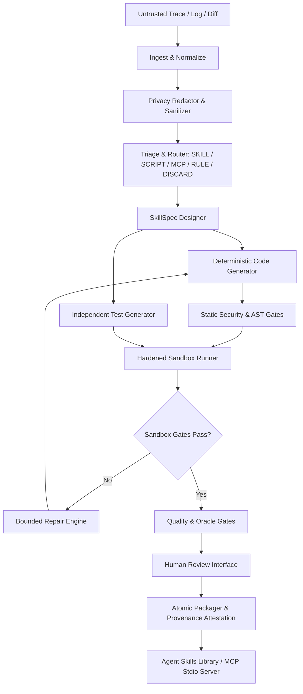

# Goldseam (agent-skill-builder)

> **A Failure-to-Skill Compiler for Agentic AI Systems.**
>
> Ingests untrusted agent execution failures, logs, transcripts, corrections, and user needs; diagnoses reusable capability gaps; designs typed `SkillSpec` contracts; generates spec-conformant Agent Skills, deterministic Python tools, and optional MCP wrappers; creates independently specified regression tests; verifies untrusted code in a constrained sandbox; repairs within bounded budgets; requests human review; packages with provenance; maintains a versioned library; and measures false acceptance with hidden-oracle benchmarks.

---

## ⚡ Quickstart (Three Commands)

```bash
# 1. Initialize local Goldseam library and environment
goldseam init

# 2. Compile an agent failure trace into a verifiable skill proposal
goldseam build --from-log tests/fixtures/traces/json_unicode_fail.log --dry-run

# 3. Verify integrity of an installed skill package
goldseam verify ~/.goldseam/skills/json-unicode-normalizer
```

---

## 🛡️ Trust Boundaries & Threat Model

1. **Untrusted Inputs:** External logs, terminal transcripts, before/after diffs, and LLM-authored code/tests are strictly treated as **untrusted**.
2. **Containment Boundary:** Untrusted generated code is **never** imported or executed in the host process. Code execution occurs inside a hardened, isolated sandbox (rootless Docker with dropped capabilities, read-only root, no network, strict CPU/memory/PIDs limits).
3. **Defense-in-Depth Heuristics:** AST analysis and import allowlists act as early-rejection filters, but are *never* relied upon as a sole security boundary.
4. **Human Review Requirement:** Executable capabilities require explicit human review and approval prior to installation into live agent skill repositories.
5. **No Blind Trust:** Risk levels are calculated by trusted deterministic policy, not by generative model self-reports.

---

## 🏗️ Architecture Overview



---

## 📦 Output Formats

- **Agent Skills:** Standard directory structure conforming to the open [Agent Skills Specification](https://agentskills.io) with valid YAML frontmatter in `SKILL.md`, executable `scripts/`, `references/`, and `tests/`.
- **Goldseam Metadata:** Pinned schemas, declared side effects, import requirements, risk assessment, and cryptographic SHA-256 provenance hashes in `goldseam.manifest.json` and `provenance.json`.
- **MCP Stdio Server:** Optional standalone [Model Context Protocol](https://modelcontextprotocol.io) stdio server sharing the same underlying pure core tools.
- **Rule-Only Output:** Structured markdown rule instructions (`RULE_ONLY`) for behavioral, procedural, or preference corrections that do not require executable code.

---

## ⚙️ Development & Installation

Goldseam requires Python 3.11+ (Python 3.12 recommended) and is managed with `uv`.

```bash
# Clone the repository
git clone https://github.com/goldseam/goldseam.git
cd goldseam

# Create virtual environment and sync dependencies
uv sync --extra dev --extra llm

# Run linting, type checks, and tests
uv run ruff check .
uv run mypy src
uv run pytest
```

---

## 📚 Documentation

- [Status and Implementation Ledger](docs/STATUS.md)
- [Requirements Verification Matrix](docs/IMPLEMENTATION_MATRIX.md)
- [Blockers & Pre-flight Diagnostics](docs/BLOCKERS.md)
- [Architecture & Threat Model](docs/architecture.md)
- [Security Policy & Sandboxing](docs/threat-model.md)
- [CLI Reference Guide](docs/cli.md)

---

## 📄 License & Security

Licensed under the [Apache License, Version 2.0](LICENSE).
To report security vulnerabilities, please refer to [SECURITY.md](SECURITY.md).
