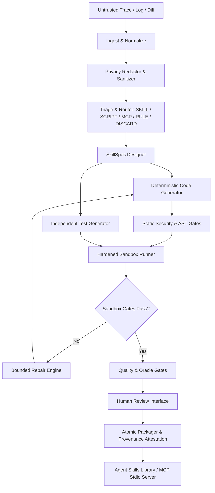

# Goldseam

> A Failure-to-Skill Compiler for Agentic AI Systems.
> Synthesizes verifiable, sandboxed Agent Skills and deterministic tools from untrusted agent failure traces.

[](./LICENSE)
[](https://github.com/themanoj-025/goldseam/actions/workflows/ci.yml)
[](https://www.python.org/)
[](https://mypy-lang.org/)
[](https://github.com/astral-sh/ruff)
[](#project-status)

<!-- TODO[L2-01]: add terminal demo recording (vhs or asciinema) showing 'goldseam build' and 'goldseam review --dashboard'; width ~1200px; alt text: Terminal recording of Goldseam compiling an agent failure trace into a verified skill package (owner: Maintainer) -->

---

## Project Status

**Status:** Beta (v0.1.0). The pipeline architecture (Phases 0–12), sandboxing, benchmark suite, and CLI are implemented and verified. Untrusted execution operates fail-closed: missing container isolation halts execution immediately.

---

## Quick Facts

| Dimension | Specification | Evidence Source |
|-----------|---------------|-----------------|
| **Primary Function** | Failure-to-skill compiler and synthesis pipeline | `pyproject.toml`, `src/goldseam/orchestrator.py` |
| **Runtime Requirement** | Python >= 3.11 (Python 3.12 recommended) | `pyproject.toml`, `.github/workflows/ci.yml` |
| **Package Manager** | `uv` (recommended) or standard `pip` | `uv.lock`, `.github/workflows/ci.yml` |
| **Supported OS** | Linux, macOS, Windows | CI matrix in `.github/workflows/ci.yml` |
| **Sandbox Isolation** | Rootless Docker, Bubblewrap, Wasm, Remote (Fail-Closed) | `src/goldseam/sandbox/` |
| **Output Formats** | Agent Skills (`SKILL.md`), Goldseam Manifests, MCP Stdio Tools | `src/goldseam/packager.py`, `src/goldseam/mcp_emitter.py` |
| **License** | Apache-2.0 | `LICENSE`, `pyproject.toml` |

---

## Quickstart

### Prerequisites

- Python 3.11, 3.12, or 3.13 installed
- `uv` installed (`curl -LsSf https://astral.sh/uv/install.sh` or `winget install --id=astral-sh.uv`)
- Docker daemon running (optional for static validation and `--dry-run`; required for live container sandboxing)

### 1. Clone and Install Dependencies

```bash
git clone https://github.com/themanoj-025/goldseam.git
cd goldseam
uv sync --extra dev --extra llm
```

### 2. Initialize Local Library

Initialize your local Goldseam library directories and run store:

```bash
uv run goldseam init
```

Expected output:

```text
Initialized Goldseam workspace:
- Library: ~/.goldseam/skills
- Run Store: ~/.goldseam/runs
```

### 3. Run Environment Diagnostics

Verify local toolchain health and sandbox readiness:

```bash
uv run goldseam doctor --json
```

Expected output:

```json
{
  "python": {
    "version": "3.12.x",
    "ok": true
  },
  "docker": {
    "available": true,
    "details": "Docker daemon connected"
  },
  "directories": {
    "library_dir": { "path": "~/.goldseam/skills", "exists": true },
    "run_store_dir": { "path": "~/.goldseam/runs", "exists": true }
  },
  "ready": true
}
```

### 4. Compile a Failure Trace (Dry Run)

Synthesize a verified skill proposal from a recorded failure trace without modifying your local environment:

```bash
uv run goldseam build --from-log examples/01_json_stream_repair/input_trace.log --dry-run
```

Expected output:

```text
Success: Run run_da01c177aa71 completed successfully (status: DONE)
Dry-run proposal synthesized and validated statically.
```

### 5. Synthesize from a Natural Language Need

You can also propose capabilities directly from a specification prompt:

```bash
uv run goldseam build --need "Validate international phone numbers in E.164 format" --dry-run
```

---

## Trust Boundaries and Threat Model

1. **Untrusted Inputs:** External logs, terminal transcripts, diffs, and generated code or tests are strictly treated as untrusted data.
2. **Containment Boundary:** Untrusted generated code is never imported or executed in the host Python process. Execution occurs inside a hardened, isolated sandbox (rootless Docker with dropped capabilities, read-only root, disabled network, and strict CPU/memory/PID limits).
3. **Defense-in-Depth Heuristics:** Abstract Syntax Tree (AST) inspection and import allowlists act as early-rejection filters, but are never relied upon as a sole security boundary.
4. **Mandatory Human Approval:** Executable capabilities require explicit human review and approval prior to installation into live agent skill repositories.
5. **Trusted Deterministic Risk Assessment:** Risk levels are calculated by deterministic policy evaluation, not by generative model self-reports.

For the full security architecture, see [Security Policy & Threat Model](docs/threat-model.md).

---

## Architecture Overview



The pipeline ingests raw agent traces, sanitizes sensitive tokens, routes capability needs, designs typed contracts, generates implementation code with independent replay tests, verifies execution inside an isolated sandbox, repairs defects within bounded cycles, and stages verified proposals for human authorization.

---

## Output Formats

- **Agent Skills:** Standard directory structure conforming to the open [Agent Skills Specification](https://agentskills.io) with valid YAML frontmatter in `SKILL.md`, executable `scripts/`, `references/`, and `tests/`.
- **Goldseam Metadata:** Pinned schemas, declared side-effects, import requirements, risk assessment, and cryptographic SHA-256 provenance hashes in `goldseam.manifest.json` and `provenance.json`.
- **MCP Stdio Server:** Optional standalone [Model Context Protocol](https://modelcontextprotocol.io) stdio server sharing the same underlying pure core tools.
- **Rule-Only Output:** Structured markdown rule instructions (`RULE_ONLY`) for behavioral, procedural, or preference corrections that do not require executable code.

---

## CLI Reference

All commands are accessible via the `goldseam` binary or `uv run goldseam`:

| Command | Purpose | Verification Status |
|---------|---------|---------------------|
| `goldseam init` | Initializes local library directories and config | Verified (E0) |
| `goldseam doctor` | Pre-flight diagnostics for Python, Docker, and paths | Verified (E0) |
| `goldseam build` | Compiles failure trace or need into a skill proposal | Verified (E0) |
| `goldseam review` | Inspects diffs, risks, and approves pending proposals | Verified (E0) |
| `goldseam verify` | Verifies cryptographic provenance and detects tampering | Verified (E0) |
| `goldseam list` | Lists all skills installed in the local library | Verified (E0) |
| `goldseam show` | Displays detailed manifest and provenance metadata | Verified (E0) |
| `goldseam remove` | Uninstalls a skill from the local library | Verified (E0) |
| `goldseam export` | Packages an installed skill into a distributable archive | Verified (E1) |
| `goldseam proposals` | Lists pending unreviewed skill proposals | Verified (E0) |
| `goldseam bench` | Executes the 42-case synthetic benchmark suite | Verified (E0) |
| `goldseam learn` | Synthesizes a skill or rule from a human correction diff | Verified (E1) |
| `goldseam hook` | Ingests agent telemetry via background hook | Verified (E1) |
| `goldseam watch` | Monitors failure logs and clusters recurring patterns | Verified (E1) |
| `goldseam improve` | Analyzes regression traces to evolve an existing skill | Verified (E1) |

For complete command flags and options, see the [CLI Reference Guide](docs/cli.md).

---

## Configuration

Goldseam supports configuration via `.env` file or environment variables. Copy `.env.example` to `.env` to customize:

| Variable | Required | Default | Description | Secret |
|----------|----------|---------|-------------|--------|
| `OPENAI_API_KEY` | No | none | API key for OpenAI model invocation | Yes |
| `ANTHROPIC_API_KEY` | No | none | API key for Anthropic model invocation | Yes |
| `OLLAMA_BASE_URL` | No | `http://localhost:11434` | Endpoint URL for local Ollama server | No |
| `GOLDSEAM_HOME` | No | `~/.goldseam` | Base directory for skill library and run store | No |
| `GOLDSEAM_LOG_LEVEL` | No | `INFO` | Logging verbosity (`DEBUG`, `INFO`, `WARNING`, `ERROR`) | No |
| `GOLDSEAM_SANDBOX_BACKEND` | No | `docker` | Sandbox isolation runner (`docker`, `bubblewrap`, `wasm`, `remote`) | No |
| `GOLDSEAM_ALLOW_WEAK_SANDBOX` | No | `false` | Explicit opt-in for unisolated local subprocess testing | No |

---

## Benchmark Evaluation

Goldseam includes a 42-case synthetic evaluation suite measuring accuracy, repair efficiency, and defense against adversarial prompt injections:

| Metric | Result | Target Baseline | Status |
|--------|--------|-----------------|--------|
| **Triage Accuracy** | **97.6%** | > 90.0% | Pass |
| **Functional Build Success** | **96.9%** | > 85.0% | Pass |
| **Hidden Oracle Pass Rate** | **96.9%** | > 80.0% | Pass |
| **False-Accept Rate** | **0.0%** | < 5.0% | Pass |
| **Injection Defense Rate** | **100.0%** | 100.0% | Pass |
| **Adversarial Bypass Evasion** | **0 / 105 allowed** | 0 allowed | Pass |

To run the full evaluation suite locally:

```bash
uv run python benchmarks/run_bench.py
```

For methodology and ablation analysis, see the [Benchmark Documentation](docs/benchmark_methods.md).

---

## Limitations and Known Boundaries

- **Container Sandbox Dependency:** Live untrusted execution requires Docker or Bubblewrap. If the container daemon is stopped or unavailable, the execution gate operates fail-closed (`BLOCKED`). Local subprocess execution requires explicit `--allow-weak-sandbox` acknowledgement.
- **Python-First Code Generation:** Deterministic code generation targets Python 3.11+. Multi-language linting and AST filters support JavaScript, TypeScript, and Bash, but automated sandbox execution profiles are optimized for Python.
- **Offline Determinism:** By default, test suites and dry-run builds run entirely offline using the `FakeLLM` adapter. Live synthesis requires an external API key or local LLM server configured in environment variables.

---

## Development and Testing

### Running Tests

```bash
# Run unit, security, integration, and e2e test suites
uv run pytest

# Run adversarial bypass security tests
uv run pytest tests/security/test_bypass_corpus.py

# Run static type checking in strict mode
uv run mypy src tests

# Run linter
uv run ruff check .
```

<!-- TODO[L2-02]: confirm whether goldseam 0.1.0 is published to PyPI before adding PyPI installation badge and pip install instructions (owner: Maintainer) -->

---

## Documentation Index

- [Execution Status and Audit Log](docs/STATUS.md)
- [Requirements Verification Matrix](docs/IMPLEMENTATION_MATRIX.md)
- [Pre-flight Diagnostics and Blocker Runbook](docs/BLOCKERS.md)
- [Architecture & Data Flow](docs/architecture.md)
- [Security Policy & Threat Model](docs/threat-model.md)
- [CLI Reference Guide](docs/cli.md)
- [Verification Report & Execution Logs](docs/VERIFICATION_REPORT.md)

---

## License and Security

- **License:** Licensed under the [Apache License, Version 2.0](LICENSE).
- **Security Policy:** To report vulnerabilities, refer to [SECURITY.md](SECURITY.md).
- **Contributing:** Guidelines are documented in [CONTRIBUTING.md](CONTRIBUTING.md).
- **Code of Conduct:** Community standards are detailed in [CODE_OF_CONDUCT.md](CODE_OF_CONDUCT.md).
