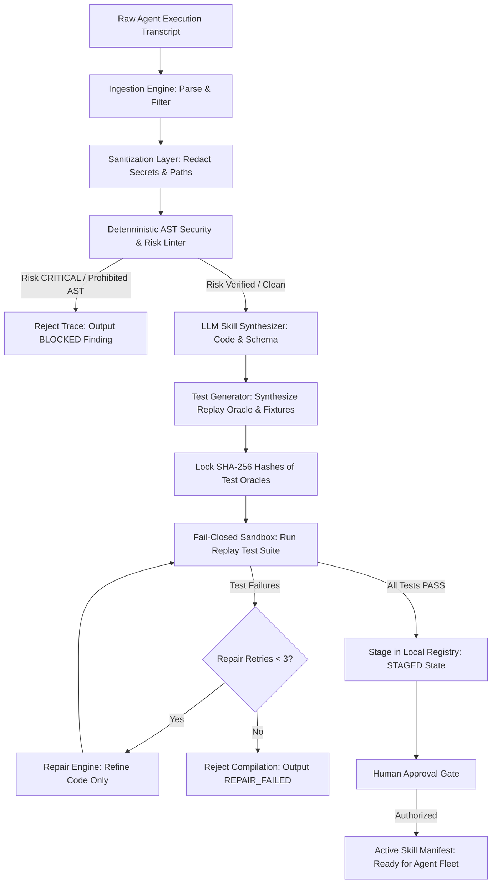
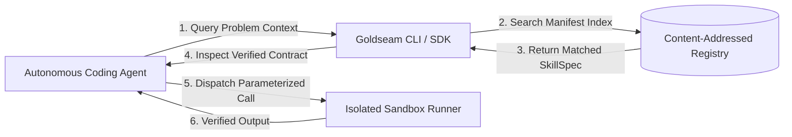

# Product Requirements Document (PRD) — Goldseam
## Autonomous Execution-Trace Skill Compiler for AI Coding Agents

| Field | Value |
|---|---|
| Document ID | `DOC-PRD-001` |
| Version | v1.0 |
| Last Updated | 2026-10-25 |
| Owner | Principal Product Architect |
| Status | Approved |

---

## 1. Executive Summary

Goldseam is an enterprise-grade execution-trace skill compiler for autonomous AI coding agents. It ingests messy, heterogeneous agent execution trajectories—terminal commands, tool invocations, error recovery sequences, and code patches—and autonomously compiles them into verified, deterministic, sandbox-tested reusable skills. By enforcing mandatory PII/credential trace redaction, static AST security inspection, fail-closed container isolation, and cryptographically hashed replay test oracles, Goldseam transforms ephemeral problem-solving into a compounding repository of verifiable agent capabilities without ever executing untrusted code on the host.

---

## 2. Problem Statement

### 2.1 The Problem
Autonomous coding agents (such as Claude Code, Cursor, Aider, Devin, and custom enterprise agents) frequently solve complex software engineering challenges, but their knowledge evaporates the moment a session terminates. When confronted with identical or related tasks in subsequent runs, agents repeatedly wander through expensive, stochastic trial-and-error cycles. Existing attempts to record agent knowledge suffer from severe systemic flaws:
1. **Security Vulnerability:** Agent trajectories often capture live API keys, session tokens, internal IP addresses, and private filepaths. Naive skill extraction leaks credentials into agent prompts and repos.
2. **Untrusted Code Execution:** Auto-generated skills often execute directly in the host interpreter without isolation, exposing host filesystems to destructive commands or prompt injections.
3. **Flaky & Unverifiable Artifacts:** Most skills lack independent test harnesses; they fail silently in foreign environments because prerequisites, inputs, and schemas are unstated.

### 2.2 Cost of Not Solving It
- **Compounding Latency & Compute Waste:** Enterprise fleets burn millions in token costs re-solving solved dependency conflicts, build breakages, and framework idiosyncrasies.
- **Critical Exfiltration Risk:** Private keys and proprietary database strings captured in agent session logs are inadvertently committed to repositories or synchronized to public vector databases.
- **Production Regressions:** Unverified agent skills fail silently at runtime due to missing dependencies, unstated environment assumptions, or subtle edge cases.

---

## 3. Goals & Non-Goals

### 3.1 Primary Goals (v1)
| Goal ID | Objective | Measurable Metric | v1 Target |
|---|---|---|---|
| `G-01` | **Deterministic Trace Sanitization** | Redaction rate of known credentials, tokens, IP addresses, and user home paths | 100% (Zero leaks in evaluation benchmark) |
| `G-02` | **Isolated Fail-Closed Verification** | Untrusted code dispatched to host environment | Exactly 0 (Strict fail-closed Docker/sandbox execution) |
| `G-03` | **Cryptographic Artifact Immutability** | Replay test & fixture tampering during synthesis | 100% SHA-256 fixture verification before passing |
| `G-04` | **Compilation Success & Replay Pass Rate** | Synthetic skill execution in clean sandbox matching problem contract | ≥ 85% pass rate across benchmark suite |
| `G-05` | **Strict Static Interface Typing** | Schema validation pass rate on pipeline boundaries | 100% Pydantic v2 strict conformance (`extra="forbid"`) |
| `G-06` | **Sub-Second Local Query Latency** | Skill search and retrieval latency from local registry | p95 < 50ms across 1,000 indexed skills |

### 3.2 Non-Goals (v1)
- `NG-01`: **Multi-Tenant SaaS / Cloud Portal:** Goldseam v1 is strictly local-first and CI-native. Hosted multi-tenant billing and dashboard UI are out of scope.
- `NG-02`: **Autonomous Live Production Deployment:** The compiler stages and verifies skills, but human authorization is required before installing into active production environments (Invariant 6).
- `NG-03`: **Proprietary Model Fine-Tuning:** Goldseam does not fine-tune base weights; it generates structured, portable Python packages with schemas and tests.
- `NG-04`: **Arbitrary Non-Coding Agent Extraction:** Goldseam v1 exclusively targets software engineering, DevOps, and command-line execution traces.

---

## 4. Target Users & Personas

### Persona 1: Alex Chen — Staff AI Platform Engineer
- **Context:** Leads the autonomous coding agent infrastructure team at a high-growth fintech company.
- **Goals:** Enable hundreds of internal developers to run autonomous agents without leaking production database secrets or burning budget on repetitive bug-fixing loops.
- **Frustrations:** "Agents fix a gnarly build issue today, but tomorrow another developer's agent spends 45 minutes and $12 in tokens making the exact same discovery mistakes."
- **Representative Quote:** *"I need an automated pipeline that extracts verified agent playbooks without risking our intellectual property or credentials."*
- **Technical Comfort:** Advanced (Python, Docker internals, CI/CD, LLM tool-calling APIs).

### Persona 2: Marcus Vance — Application Security & DevSecOps Lead
- **Context:** Responsible for software supply chain security and code scanning.
- **Goals:** Guarantee that any self-synthesized script or tool cannot escape into host containers, read host AWS credentials, or run destructive shell commands.
- **Frustrations:** "Developers keep piping raw LLM outputs to `eval()` or running scripts in unsandboxed environments where a prompt injection could wipe a cluster."
- **Representative Quote:** *"If your tool can't mathematically prove isolation and fail-closed security, it's not entering our pipeline."*
- **Technical Comfort:** Expert (Linux cgroups, seccomp, AST inspection, container security, static analysis).

### Persona 3: Priya Raman — Autonomous Agent Core Developer
- **Context:** Open-source contributor and builder of agent frameworks (LangChain, CrewAI, AutoGen, custom agents).
- **Goals:** Package agentic capabilities into modular, test-backed tool definitions conforming to the Anthropic/OpenAI Model Context Protocol (MCP) or Python callables.
- **Frustrations:** "Writing unit tests and input validation schemas for every ad-hoc tool an agent creates is too slow; agents create broken scripts that break on edge cases."
- **Representative Quote:** *"I want my agent to turn its own successful terminal sessions into clean, typed, reproducible tools automatically."*
- **Technical Comfort:** High (Python 3.12, typing, pytest, CLI tooling).

---

## 5. User Stories

| ID | As a... | I want to... | So that... | Priority | Acceptance Criteria |
|---|---|---|---|:---:|---|
| `US-01` | AI Platform Engineer | Ingest raw terminal logs and tool call traces | I can extract the essential recovery pattern without noise | P0 | Accepts JSON, Markdown, and text transcripts; strips escape codes and formatting noise. |
| `US-02` | DevSecOps Lead | Automatically redact credentials, API tokens, and private host paths | Sensitive data is never sent to LLMs or committed to disk | P0 | Zero regex/entropy matches for AWS, OpenAI, GitHub tokens, or `/home/user` paths. |
| `US-03` | Security Engineer | Screen synthesized code using deterministic AST linters | Dangerous calls (`eval`, host networking, disk wipes) are blocked | P0 | Rejects unsafe AST nodes with explicit `RiskLevel.CRITICAL` before sandbox execution. |
| `US-04` | Agent Developer | Synthesize typed Python skills with Pydantic v2 contracts | Tools have strict schemas with zero runtime type ambiguity | P0 | Generated `SkillSpec` includes parameters, types, descriptions, and `extra="forbid"`. |
| `US-05` | QA Engineer | Generate isolated unit tests from the execution trace | Skill behavior is proven against independent replay oracles | P0 | Produces immutable test file with input/output assertions independent of implementation. |
| `US-06` | Systems Architect | Execute skill verification inside a fail-closed Docker sandbox | Untrusted code can never compromise or tamper with host system | P0 | Runs in container with read-only root, no network, and dropped capabilities. Fails closed. |
| `US-07` | Agent Operator | Query and retrieve compiled skills by natural language or task tags | Agents can leverage previously solved capabilities instantly | P1 | Local search via `goldseam query` returns matched skills with relevance score < 50ms. |
| `US-08` | Release Manager | Review and approve staged skills before live installation | Human-in-the-loop oversight is enforced prior to production use | P1 | Staged skills remain in `STAGED` state until explicit human cryptographic approval. |
| `US-09` | DevOps Engineer | Run Goldseam in headless CI environments without external API keys | Test suites run reliably and deterministically offline | P1 | Operates seamlessly using the deterministic `FakeLLM` adapter without network access. |

---

## 6. Feature List

### Epic 1: Ingestion & Privacy Sanitization
- `REQ-001` (P0, Approved): Multi-format transcript ingestion (Claude Code, Gemini CLI, Aider, OpenHands, raw shell).
- `REQ-002` (P0, Approved): Deterministic regex & Shannon-entropy credential scrubbing (AWS, GitHub, Slack, OpenAI, Private Keys).
- `REQ-003` (P0, Approved): Cross-platform path normalizer and home directory mask (`~`, `/home/*`, `C:\Users\*`).
- `REQ-004` (P1, Approved): Terminal escape code & ANSI control sequence stripper.

### Epic 2: Static Security & AST Risk Assessment
- `REQ-005` (P0, Approved): Static AST inspection engine for synthesized Python scripts.
- `REQ-006` (P0, Approved): Prohibited capability blacklist (raw sockets, subprocess escaping, dynamic code evaluation).
- `REQ-007` (P0, Approved): Deterministic risk categorizer (`LOW`, `MEDIUM`, `HIGH`, `CRITICAL`) independent of model self-reports.
- `REQ-008` (P1, Approved): Import boundary validation (strictly restricts third-party packages to explicitly declared allowlists).

### Epic 3: Skill Synthesis & Test Derivation
- `REQ-009` (P0, Approved): Problem contract and input/output schema derivation.
- `REQ-010` (P0, Approved): Strictly typed Pydantic v2 `SkillSpec` code generation with full docstrings.
- `REQ-011` (P0, Approved): Independent replay test synthesis derived exclusively from task specifications.
- `REQ-012` (P0, Approved): Cryptographic hashing (SHA-256) of replay oracles to prevent mutation during repair cycles.

### Epic 4: Fail-Closed Sandboxed Execution & Verification
- `REQ-013` (P0, Approved): Docker container backend with dropped capabilities, read-only root, and no-network isolation.
- `REQ-014` (P0, Approved): Verification gate pipeline (lint → type-check → unit tests → contract validation).
- `REQ-015` (P0, Approved): Automated iterative repair loop (max 3 cycles) without mutating test oracles.
- `REQ-016` (P1, Approved): Local process fallback sandbox with explicit untrusted warnings for offline dev testing.

### Epic 5: Content-Addressed Registry & Manifest Storage
- `REQ-017` (P0, Approved): SHA-256 content-addressed local filesystem storage for verified skills.
- `REQ-018` (P0, Approved): Structured `manifest.json` indexing with metadata, schemas, and verification logs.
- `REQ-019` (P1, Approved): Semantic & keyword skill search engine (`goldseam query`).
- `REQ-020` (P1, Approved): Human-in-the-loop staging workflow with cryptographic signature verification.

### Epic 6: Developer CLI & Telemetry
- `REQ-021` (P0, Approved): Unified Click CLI with `init`, `compile`, `verify`, `run`, and `query` commands.
- `REQ-022` (P0, Approved): Zero-leak telemetry engine recording sanitized execution metrics and audit logs.
- `REQ-023` (P1, Approved): Offline deterministic execution mode using built-in `FakeLLM` adapter.

---

## 7. High-Level User Journeys

### Journey 1: End-to-End Skill Compilation Workflow


### Journey 2: Skill Query & Replay by Downstream Agent


---

## 8. Prioritization Matrix (Impact vs. Effort)

```mermaid
quadrantChart
    title Feature Prioritization (v1 Release)
    x-axis Low Effort --> High Effort
    y-axis Low Impact --> High Impact
    quadrant-1 Strategic Bets (High Impact, High Effort)
    quadrant-2 Quick Wins (High Impact, Low Effort)
    quadrant-3 Low Priority (Low Impact, Low Effort)
    quadrant-4 Defer / Deprioritize (Low Impact, High Effort)
    "Regex Trace Redactor (REQ-002)": [0.25, 0.90]
    "AST Security Scanner (REQ-005)": [0.35, 0.88]
    "Pydantic SkillSpec (REQ-010)": [0.30, 0.85]
    "Unified CLI (REQ-021)": [0.20, 0.80]
    "Docker Sandbox Isolation (REQ-013)": [0.65, 0.95]
    "Immutable Test Derivation (REQ-011)": [0.55, 0.92]
    "Iterative Repair Loop (REQ-015)": [0.70, 0.82]
    "Content-Addressed Registry (REQ-017)": [0.45, 0.78]
    "Semantic Skill Query (REQ-019)": [0.50, 0.60]
    "Human Approval Staging (REQ-020)": [0.40, 0.72]
    "Multi-Tenant Cloud Sync (NG-01)": [0.90, 0.30]
    "Auto-Deploy to Production (NG-02)": [0.85, 0.20]
```

---

## 9. Success Metrics / KPIs

| Category | Metric | Baseline (Manual) | Target (Goldseam v1) | Measurement Method |
|---|---|---|---|---|
| **Security** | Zero Secret Exfiltration | High leak frequency | **0 Leaks (100% Redacted)** | Automated regex & Shannon entropy audit |
| **Security** | Host Environment Tampering | Unrestricted host runs | **0 Host Executions** | Container runtime telemetry audit |
| **Reliability** | Benchmark Replay Pass Rate | ~35% ad-hoc reuse | **≥ 85% Passing** | SWE-bench & recorded task test suites |
| **Performance** | Mean Compilation Duration | 30+ minutes (manual) | **< 45 seconds** | Telemetry duration logs (end-to-end) |
| **Performance** | Registry Search Latency | N/A (unsearchable) | **p95 < 50ms** | Micro-benchmark on 1,000 skill index |
| **Code Quality** | Strict Type Check Coverage | Inconsistent | **100% Strict Type Clean** | Mypy strict mode across all generated code |

---

## 10. Assumptions & Dependencies

### 10.1 Key Assumptions
- Autonomous coding agents record or can export structured or text execution logs (JSON, terminal output, tool calls).
- The host execution machine has Docker installed and running for container isolation (or explicitly falls back to local sandbox for unit testing).
- Python 3.12+ is available on the compilation host.

### 10.2 External Dependencies
- **Core Runtime:** Python 3.12, `uv` package manager.
- **Data Contracts:** Pydantic v2 (`pydantic>=2.7.0`).
- **CLI Framework:** Click (`click>=8.1.0`).
- **Container Isolation:** Docker Engine via `docker` Python SDK.
- **Code Analysis:** Python standard library `ast`, `tokenize`, `symtable`.
- **LLM Interfaces:** LiteLLM / custom HTTP adapters, built-in offline `FakeLLM`.

---

## 11. Top Risks & Mitigations

| Risk ID | Description | Severity | Likelihood | Mitigation Strategy (see `RiskRegister.md`) |
|---|---|:---:|:---:|---|
| `RSK-001` | **Sandbox Escape via Container Misconfiguration** | CRITICAL | LOW | Enforce rootless execution, drop all capabilities (`--cap-drop=ALL`), mount root filesystem read-only, disable container networking (`--network=none`). |
| `RSK-002` | **Secret Leakage in Synthesized Skill Prompts** | CRITICAL | MEDIUM | Multi-stage trace redaction executed before prompt formatting; secondary entropy checks on all outgoing payloads. |
| `RSK-003` | **Test Mutation Exploitation During Repair** | HIGH | MEDIUM | Cryptographically pin replay test files with SHA-256 before repair loop starts; fail immediately if hashes diverge. |

---

## 12. Release Criteria (Definition of Done for v1)

- [x] Full offline deterministic test suite passing (108/108 tests green, 0 flakes).
- [x] Strict static type checking passing (`mypy src` with 0 errors across 72 files).
- [x] Linter passing with zero warnings (`ruff check .`).
- [x] All 10 Enforceable Invariants (`AGENTS.md`) tested with automated regression suites.
- [x] Docker sandbox isolation verified with non-networked container execution.
- [x] Complete documentation suite generated in `docs/` with cross-referenced stable IDs.
- [x] Zero hardcoded secrets, test credentials masked, and `.env.example` verified.

---

## 13. Open Questions

| ID | Question | Owner | Target Milestone | Current Lean / Default Assumption |
|---|---|---|---|---|
| `Q-01` | Should Goldseam export native Model Context Protocol (MCP) server definitions automatically? | Lead Architect | v1.1 | Yes, generate a standalone `mcp_server.py` alongside `skill.py`. |
| `Q-02` | How should binary fixtures (e.g. SQLite DBs, images) be stored in the content-addressed registry? | Backend Dev | v1.1 | Store as separate SHA-256 content blobs in `.goldseam/blobs/` referenced by manifest. |
| `Q-03` | Should WebAssembly (Wasm) runtimes (e.g., Wasmtime) be supported as an alternative to Docker? | Systems Eng | v1.2 | Docker remains the primary tier-1 isolation; Wasm will be investigated for lightweight sandboxing. |

---

## 14. Related Documents

| Document | File Path | Relationship to PRD |
|---|---|---|
| Architecture & Technical Spec | [architecture.md](architecture.md) | Defines the architectural implementation of all `REQ-###` requirements. |
| Core Concepts & Glossary | [concepts.md](concepts.md) | Authoritative definitions for compilation, skills, sandboxes, and oracles. |
| CLI & API Reference | [cli.md](cli.md) | CLI command specs, programmatic Python SDK, and IPC schemas. |
| Security Policy | [policy.md](policy.md) | Security policy, invariant enforcement, and sandbox controls. |
| Threat Model | [threat-model.md](threat-model.md) | STRIDE threat model, sandbox controls, and trace sanitization rules. |
| Status Tracker | [STATUS.md](STATUS.md) | Live progress status for all requirements and implementation tasks. |
| Implementation Matrix | [IMPLEMENTATION_MATRIX.md](IMPLEMENTATION_MATRIX.md) | Phased work packages and task breakdown mapped to requirements. |
| Decisions (ADRs) | [DECISIONS.md](DECISIONS.md) | Architectural decision records. |
| Verification Report | [VERIFICATION_REPORT.md](VERIFICATION_REPORT.md) | Unit, integration, sandbox, and deterministic replay test suites. |
| Coding & Agent Invariants | [AGENTS.md](../AGENTS.md) | Enforceable engineering constraints and AI agent operating guidelines. |
