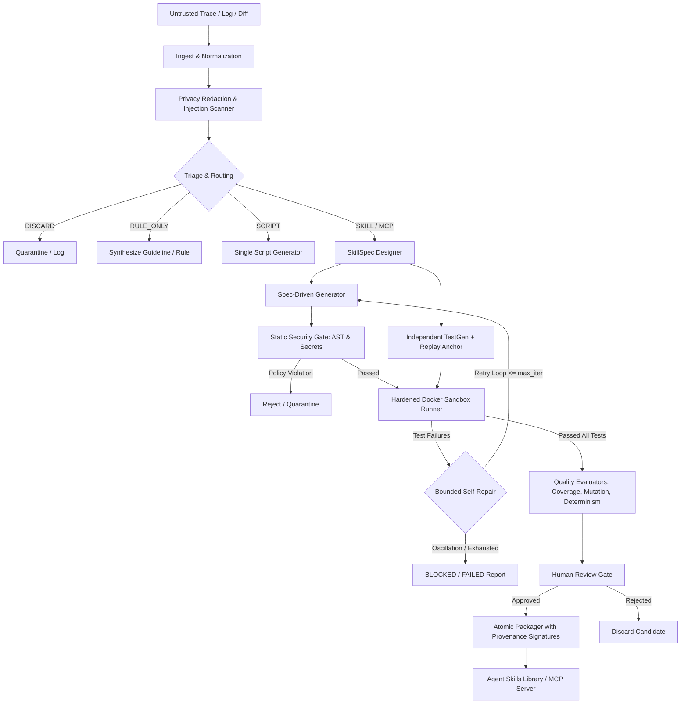
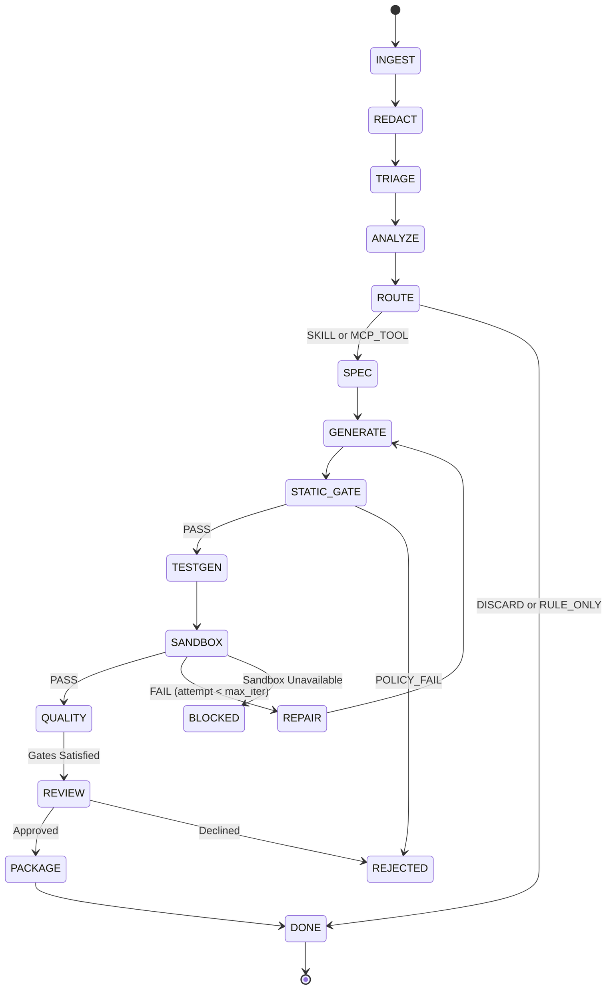

# Goldseam Architecture Specification

## System Overview
Goldseam transforms unstructured failure traces into spec-compliant, sandboxed, and verified Agent Skills.

### Core Pipelines and Stages

1. **Ingestion & Normalization (`src/goldseam/ingest/`):**
   - Ingests terminal logs, pytest logs, Python tracebacks, unified diffs, and plain text.
   - Normalizes ANSI escape sequences, CRLF/LF line endings, and file paths.
   - Computes unique error signatures and trace event streams.

2. **Sanitization & Redaction (`src/goldseam/ingest/redact.py`):**
   - Detects credentials, high-entropy API keys (OpenAI, AWS, GitHub), tokens, IPs, emails, and home directories.
   - Substitutes sensitive tokens with deterministic typed placeholders (e.g. `[REDACTED_API_KEY_1]`).
   - Flags prompt injection attempts, role-spoofing markers, and unescaped delimiters.

3. **Triage & Routing (`src/goldseam/core/triage.py`, `router.py`):**
   - Evaluates recurrence, determinism, generality, impact, risk, and available oracle.
   - Routes to one of five explicit target classes:
     - `SKILL`: Multi-step procedure, tool invocation, or structured capability.
     - `SCRIPT`: One-off deterministic utility script.
     - `MCP_TOOL`: Interactive tool suitable for Model Context Protocol server.
     - `RULE_ONLY`: Behavioral preference or coding convention requiring only documentation / agent instructions.
     - `DISCARD`: Transient error, network timeout, user typo, or non-reusable incident.

4. **Skill Specification Designer (`src/goldseam/core/spec_designer.py`):**
   - Synthesizes a formal `SkillSpec` contract: trigger terms, non-triggers, inputs, outputs, JSON Schemas, preconditions, side effects, and examples.

5. **Code & Test Generation (`src/goldseam/core/generator.py`, `testgen.py`):**
   - **Generator:** Emits spec-pure `SKILL.md` (frontmatter adhering to `agentskills.io`), pure core Python module, and CLI entrypoint.
   - **TestGen:** Derives pytest test suites directly from `SkillSpec` contracts and sanitized failure replay anchors *independently* of generated code.

6. **Static & AST Policy Gates (`src/goldseam/security/`):**
   - Validates Python AST against a strict import allowlist, disallowing dynamic evaluation (`eval`, `exec`, `__import__`, `globals()`).
   - Scans for embedded secrets or suspicious outbound requests.
   - Lints `SKILL.md` against frontmatter schema constraints.

7. **Sandbox Execution (`src/goldseam/sandbox/`):**
   - Executes generated test suites within a hardened container sandbox (Docker).
   - Validates resource limits (memory, CPU, timeout) and enforces network disconnection (`--network none`).
   - Captures structured execution outcomes (`PASS`, `FAIL`, `TIMEOUT`, `OOM`, `CRASH`, `BLOCKED`).

8. **Bounded Self-Repair (`src/goldseam/core/repair.py`):**
   - If tests fail, structured error packets (assertions, diffs, stderr) are passed to a repair generator.
   - Replay anchors and test specifications are frozen and immutable.
   - Detects oscillation and halts on budget/iteration limits.

9. **Packaging, Provenance & Review (`src/goldseam/registry/`):**
   - Verifies SHA-256 integrity trees across all generated files.
   - Generates `goldseam.manifest.json` and `provenance.json` avoiding self-referential hash cycles.
   - Provides a human review CLI interface before final installation into the agent skill directory.

## Architecture Diagram

## State Machine

